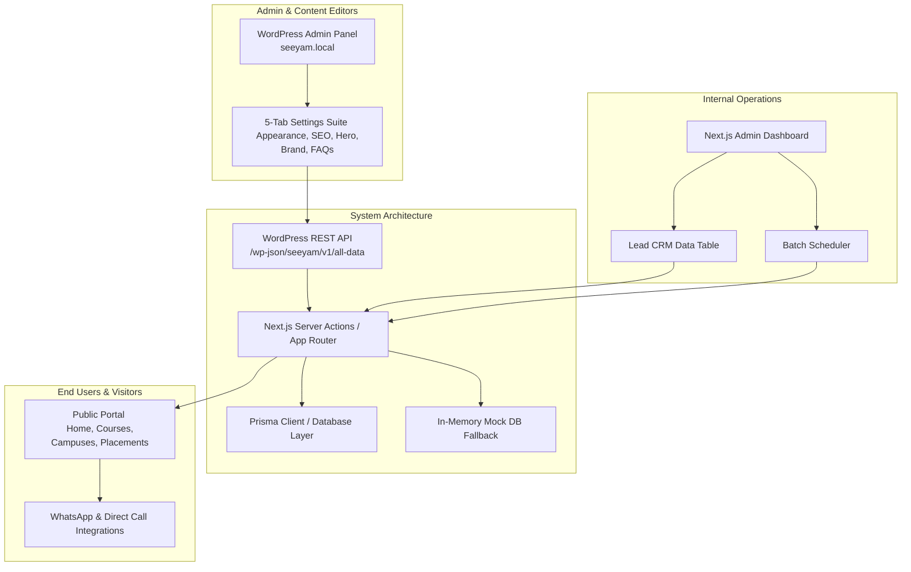

# Seeyam Technologies Platform
## IT Training, Certification & Placement Management Suite
### Project Presentation & Technical Overview

---

## 📋 Executive Summary

The **Seeyam Technologies Platform** is a modern, high-performance, enterprise-grade web application designed specifically for IT training institutes. The platform bridges the gap between public-facing marketing operations and internal business workflows (Lead Management, Course Scheduling, and Placement Tracking).

By combining a **lightning-fast Next.js frontend**, a **headless WordPress CMS**, and a **robust Lead CRM panel**, the suite provides non-technical administrators with full control over the website's themes, copy, and SEO, while providing counseling staff with a central workspace to manage leads and student placements.

---

## 🎯 Key Business Objectives

1. **Maximize Student Conversions:** Provide friction-free lead capture forms, live course search, floating WhatsApp calls-to-action (CTAs), and campus directories.
2. **Empower Non-Technical Staff:** Make all website copy, themes, colors, FAQs, and trainer profiles fully editable via a familiar WordPress administrative backend.
3. **Streamline Lead Pipelines:** Centralize inquiries in a secure CRM with real-time status updates and timestamped counselor follow-up logs.
4. **Ensure Modern Performance & SEO:** Maximize page speed and search presence via Next.js server-side rendering (SSR), static site generation (SSG), and integrated metadata options.

---

## 🏛️ System Architecture & Integrations

The platform features a decoupled, hybrid architecture leveraging the strengths of three main systems:

### 1. The Next.js Public Portal
A fast, responsive web portal serving as the digital storefront for Seeyam Technologies.
*   **Dynamic Landing Page:** Features a hero banner, real-time course search, training statistics, student reviews, and a campus map locator.
*   **Global Megamenu:** Categorized menu with instant shortcuts to trending certification courses.
*   **Lead Captures:** Zod-validated entry forms that prevent duplicate submissions and automatically sync with the backend.

### 2. WordPress Headless CMS (`seeyam-headless-cms` Plugin)
The WordPress instance acts strictly as a headless database for public page copy, brand presets, and layouts. The custom plugin includes a **5-Tab Settings Suite**:
*   🎨 **Appearance Tab:** Custom hex colors (primary/accent), Google fonts, and button corner radiuses.
*   🔍 **SEO & Analytics Tab:** Meta titles/keywords, Open Graph social cards, and Google Analytics / Google Tag Manager tracking IDs.
*   📝 **Hero & CTA Tab:** Main headlines, YouTube video showcases, training metrics, and custom button scripts.
*   🏷️ **Brand & Footer Tab:** Corporate brand naming, navbar trust badges, company description paragraphs, and social media links.
*   📖 **About Us & FAQs Tab:** Mission/vision statements, interactive accordion FAQs, editable milestone timelines, and senior faculty profiles.

### 3. Next.js Internal Lead CRM & Admin Portal
A separate, secure console located at `/admin` for internal counselor teams:
*   **KPI Metrics Dashboard:** Real-time counters showing Total Leads, New Inquiries Today, Enrolled Rates, and Active Batches.
*   **CRM Lead Sheet:** A multi-filtered table allowing counselors to update lead statuses (New, Contacted, Counseling, Enrolled, Dropped) and add timestamped follow-up history logs.
*   **Walk-in Capture & CSV Reporting:** Ability to manually register walk-in candidates and export filtered lead lists as CSV files with a single click.

---

## 🛠️ Complete Feature Walkthrough

### 🚀 Public Website Elements

| Feature Page / Component | Purpose | WordPress Control (Editable Fields) |
| :--- | :--- | :--- |
| **Hero & Quick Search** | Greets visitors, allows quick filter search of courses, and captures initial inquiries. | Badge text, Headline, Subtitle, Value-props, YouTube URL & Badges |
| **Mega-Menu Navbar** | Provides clean navigation links to pages and course categories. | 3 top trust badges, primary brand names, helpline number |
| **Course Showcases** | Displays courses inside categorical tabs with mode (Online/Hybrid/Classroom), price, and duration badges. | Title details, category titles, and individual course curriculum pages |
| **Placement Story Grid** | Loops hiring partners and recent alumni success cards showing company, role, and package CTC. | Recruiter network headings, partner company names |
| **Multi-Branch Locator** | Shows campus location details with click-to-call links, WhatsApp chat triggers, and Google Map embeds. | Add/update branches, addresses, direct contact links, map iframe urls |
| **About Us Page** | Builds trust by detailing the company's background, core values, faculty, and historic milestones. | Mission, Vision, Why Choose Advantage Pillars, Mentor Bio list, Company Timeline |
| **FAQ Page** | Reduces repetitive phone inquiries using drop-down Q&A accordions. | Repeater array of questions and answers |

---

### 🛡️ Admin CRM & Operations Workspace

*   **Lead Status Management:** Lead statuses can be altered inline directly inside the datatable. Changing a status automatically prompts the counselor for a progress note.
*   **Notes Timeline:** Every lead profile keeps a chronological trail of updates, tracking when notes were added and by whom, ensuring transparency.
*   **Upcoming Batch Schedulers:** Manage batch seat allocations, instructor names, start dates, and time slots.
*   **Dual Storage Design:** Works out-of-the-box using a local SQLite/PostgreSQL connection via **Prisma ORM**, but features a built-in mock/in-memory adapter that automatically falls back to static seed data if the databases are offline during demonstrations.

---

## 💎 Technical Highlights & Modern Stack

The code adheres to clean architecture principles:
*   **Framework:** Next.js (App Router, Server Components & Server Actions).
*   **Styling:** Tailwind CSS with modern utilities (glassmorphism, gradients, hover micro-animations).
*   **Data Validation:** Zod schema validation on both the client (forms) and server (actions) to prevent malformed submissions.
*   **Database Connectivity:** PostgreSQL with Prisma ORM (production ready) alongside an interactive fallback client interface.
*   **API Pipeline:** WordPress settings are cached with a **30-second Incremental Static Regeneration (ISR)** window to ensure lightning-fast client loading times without overloading the WordPress backend.

---

## 🌟 Why Clients Love This Setup

1. **Blazing Fast Load Times:** Next.js Server Components compile static HTML pages on the server, drastically outperforming standard WordPress pages in speed, SEO ranks, and Mobile Lighthouse scores.
2. **Simplified Content Editing:** Admins do not need to edit code to tweak spacing, change colors, or update text. Everything is handled via the intuitive WordPress settings panel.
3. **Operational Security:** Leads and student information are separated from public-facing site servers. Public users cannot access or exploit the CRM endpoints.
4. **Resiliency:** If WordPress goes offline for maintenance, the Next.js site remains online and functional using its built-in fallback dataset.
