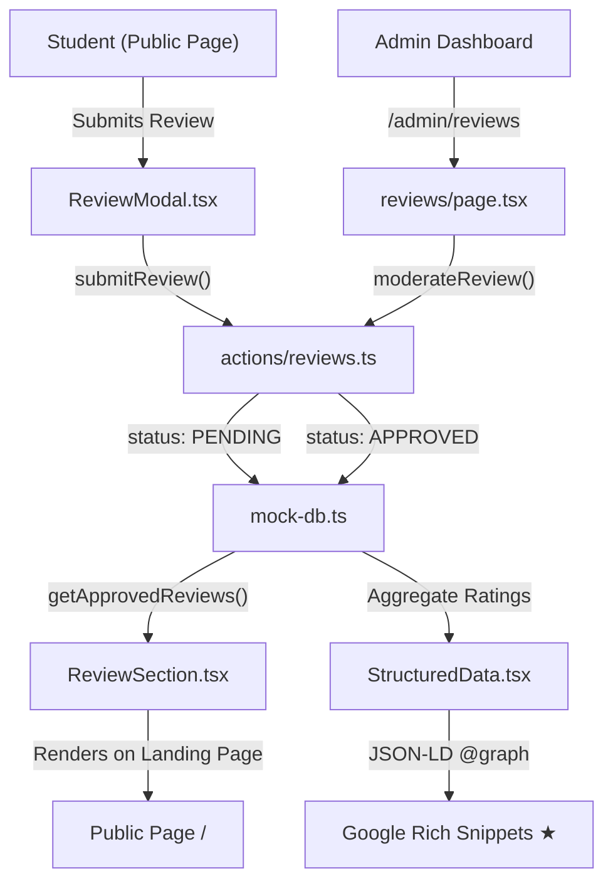

# Student Review & Testimonial System

Add a complete review system where students can submit course reviews visible on the public landing page, with admin moderation controls and SEO-optimized review schema markup.

---

## Proposed Changes

### Data Layer

#### [MODIFY] [mock-data.ts](file:///d:/greens/lib/mock-data.ts)
- Add `ReviewData` interface:
  ```ts
  interface ReviewData {
    id: string;
    studentName: string;
    studentEmail: string;
    courseId: string;
    branchId: string;
    rating: number;          // 1–5 stars
    title: string;           // "Excellent Java training!"
    body: string;            // Detailed review text
    completionYear: string;  // "2026"
    status: "PENDING" | "APPROVED" | "REJECTED";
    adminNote?: string;      // Internal moderation note
    createdAt: string;
    updatedAt: string;
  }
  ```
- Add `MOCK_REVIEWS` seed array with **8–10 pre-approved** sample reviews spread across different courses and branches (realistic student names, review titles, and 150-word bodies).

#### [MODIFY] [mock-db.ts](file:///d:/greens/lib/mock-db.ts)
- Add review CRUD methods:
  - `getReviews(params?)` — filter by `courseId`, `branchId`, `status`, with pagination
  - `getApprovedReviews(courseId?)` — only `APPROVED` reviews for public display
  - `createReview(data)` — new review with `status: "PENDING"`
  - `updateReviewStatus(id, status, adminNote?)` — approve/reject with optional admin note
  - `deleteReview(id)` — hard delete
  - `getReviewStats()` — aggregate average rating, total count, rating distribution (5★/4★/3★/2★/1★)

---

### Validation Layer

#### [MODIFY] [schema.ts](file:///d:/greens/lib/validations/schema.ts)
- Add `publicReviewSchema` (for student submissions):
  ```
  studentName: string (2–100 chars)
  studentEmail: email
  courseId: string (required)
  branchId: string (required)
  rating: number (1–5)
  title: string (5–100 chars)
  body: string (20–1000 chars)
  completionYear: string (4-digit year)
  ```
- Add `reviewModerationSchema` (for admin actions):
  ```
  reviewId: string
  newStatus: "APPROVED" | "REJECTED"
  adminNote: string (optional)
  ```

---

### Server Actions

#### [NEW] [reviews.ts](file:///d:/greens/actions/reviews.ts)
- `submitReview(formData)` — public-facing action for students to submit reviews (sets `status: "PENDING"`)
- `getApprovedReviews(courseId?)` — fetch approved reviews for public display
- `getAllReviews(params?)` — admin: paginated, filterable list of all reviews
- `moderateReview(reviewId, status, adminNote?)` — admin: approve or reject
- `deleteReview(id)` — admin: permanently remove a review

---

### Public Landing Page Components

#### [NEW] [ReviewSection.tsx](file:///d:/greens/components/ReviewSection.tsx)
A premium testimonial section placed between **PlacementSection** and **BranchLocator** on the landing page:

- **Section Header**: "What Our Alumni Say" with aggregate rating badge (e.g., "4.8/5 from 2,400+ reviews")
- **Rating Distribution Bar**: Visual horizontal bars for 5★ to 1★ breakdown
- **Review Cards Carousel/Grid**: 
  - Student avatar initial, name, course completed badge, star rating
  - Review title (bold), review body excerpt (clamp 3 lines, expandable)
  - Completion year tag, branch campus tag
  - Verified checkmark badge for approved reviews
- **"Write a Review" CTA Button**: Opens the review submission modal
- **Filter Tabs**: "All Courses" / Category-based filters (Full Stack, Cloud, AI, Testing)
- **Micro-animations**: Staggered card fade-in, star rating fill animation

#### [NEW] [ReviewModal.tsx](file:///d:/greens/components/ReviewModal.tsx)
Slide-over or centered modal for students to submit a review:

- Star rating selector (interactive clickable stars)
- Course & branch dropdowns (pre-filled from MOCK data)
- Review title & body text inputs
- Completion year dropdown
- Name & email fields
- Client-side Zod validation with React Hook Form
- Success confirmation with "Your review will appear after moderation" message

#### [MODIFY] [page.tsx](file:///d:/greens/app/page.tsx)
- Import and render `<ReviewSection />` between `<PlacementSection />` and `<BranchLocator />`

---

### Admin Dashboard

#### [NEW] [page.tsx](file:///d:/greens/app/admin/(dashboard)/reviews/page.tsx)
A full admin review moderation page:

- **KPI Strip**:
  - Total Reviews | Pending Moderation | Approved | Rejected
  - Average Platform Rating (aggregate across all courses)
- **Filter Bar**: Search by student name, filter by course, branch, status, and rating
- **Review Data Table**:
  - Columns: Student | Course | Rating (star display) | Title (excerpt) | Status | Date | Actions
  - **Inline Status Controls**: Approve ✅ / Reject ❌ buttons per row
  - **Expandable Row**: Click to see full review body and admin note textarea
  - **Bulk Actions**: Select multiple → Approve All / Reject All
- **Review Detail Slide-Over**: Full review content, student info, admin moderation note input, approve/reject/delete buttons

#### [MODIFY] [Sidebar.tsx](file:///d:/greens/components/admin/Sidebar.tsx)
- Add "Student Reviews" nav item under the **"Growth & Visibility"** group:
  ```
  { name: "Student Reviews", href: "/admin/reviews", icon: MessageSquareText, badge: "New" }
  ```

---

### SEO / Structured Data

#### [MODIFY] [StructuredData.tsx](file:///d:/greens/components/StructuredData.tsx)
- Add `AggregateRating` and `Review` schema entries to the `@graph` payload:
  - Attach aggregate review ratings to each `Course` schema object
  - Add individual approved reviews as `Review` schema entries for rich snippet eligibility
  - This enables Google Search to display ★ star ratings in search results

---

## Component Architecture



---

## Verification Plan

### Automated Tests
```bash
npm run build
```
- Verify all 15+ routes compile (new `/admin/reviews` route added)
- Zero TypeScript errors

### Manual Verification
1. Navigate to public landing page → verify ReviewSection renders between Placements and Branch Locator
2. Click "Write a Review" → verify modal opens with star selector and form validation
3. Submit a review → verify success message ("pending moderation")
4. Navigate to `/admin/reviews` → verify the new review appears with "PENDING" status
5. Click Approve → verify review now appears on the public landing page
6. Inspect page source → verify JSON-LD `Review` and `AggregateRating` schema entries

---

## Open Questions

> [!IMPORTANT]
> **Review Visibility**: Should reviews be visible immediately on submission, or only after admin approval? The plan above defaults to **moderation-first** (reviews appear only after admin approves). Let me know if you prefer instant visibility.

> [!NOTE]
> **Google Reviews Integration**: In the future, this system can be extended to pull in reviews from Google Business Profile via the Places API. The current plan focuses on self-hosted reviews only.
