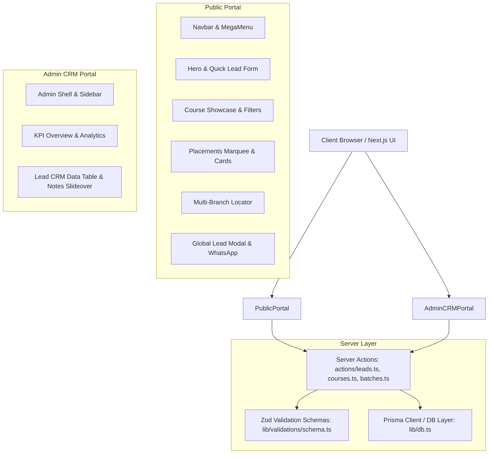

# Implementation Plan: IT Training, Certification & Placement Web Platform

Build a modern, high-performance IT Training, Certification, and Placement Management Web Platform with Next.js (App Router, Server Components, Server Actions), TypeScript, Tailwind CSS, Lucide Icons, PostgreSQL with Prisma ORM, and Zod.

## User Review Required

> [!IMPORTANT]
> - **Dual Storage Strategy**: We will implement a full Prisma schema for PostgreSQL alongside an in-memory/fallback database adapter (`lib/mock-db.ts`) so the entire application functions immediately for demonstration, testing, and dev without requiring an active PostgreSQL connection, while seamlessly connecting to PostgreSQL when `DATABASE_URL` is configured.
> - **Lead CRM Workflows**: All CRM actions (inline status updates, counselor timestamped notes, walk-in lead captures, CSV exports) will be fully implemented via Server Actions and interactive client components.

## Architecture & Tech Stack

---

## Proposed Changes

### 1. Project Configuration & Core Styles
- [NEW] [`package.json`](file:///d:/greens/package.json) - Dependencies (`next`, `react`, `react-dom`, `@prisma/client`, `prisma`, `zod`, `react-hook-form`, `@hookform/resolvers`, `lucide-react`, `clsx`, `tailwind-merge`)
- [NEW] [`tsconfig.json`](file:///d:/greens/tsconfig.json) - Strict TypeScript configuration with `@/*` path alias
- [NEW] [`tailwind.config.ts`](file:///d:/greens/tailwind.config.ts) - Modern enterprise color palette (emerald/teal/indigo/slate), animations, and glassmorphism
- [NEW] [`postcss.config.js`](file:///d:/greens/postcss.config.js) - PostCSS plugins
- [NEW] [`next.config.ts`](file:///d:/greens/next.config.ts) - Next.js configuration

### 2. Database Schema & Data Layer
- [NEW] [`prisma/schema.prisma`](file:///d:/greens/prisma/schema.prisma) - Complete schema with models: `User`, `Category`, `Course`, `Batch`, `Branch`, `Lead`, `PlacementStory` and enums `Role`, `Mode`, `BatchStatus`, `LeadStatus`.
- [NEW] [`lib/db.ts`](file:///d:/greens/lib/db.ts) - Prisma client singleton with fallback data store.
- [NEW] [`lib/mock-data.ts`](file:///d:/greens/lib/mock-data.ts) - Rich seed data for courses (Full Stack, Cloud/DevOps, AI, Testing), branches (Chennai, Bangalore, Hyderabad, Pune), batches, placement stories, and sample leads.

### 3. Validation Schemas & Server Actions
- [NEW] [`lib/validations/schema.ts`](file:///d:/greens/lib/validations/schema.ts) - Zod schemas for public leads, CRM status updates, counselor notes, batch creation, course creation, and filters.
- [NEW] [`actions/leads.ts`](file:///d:/greens/actions/leads.ts) - Server actions for lead submission, duplicate prevention, status updates with counselor logs, filtering, and CSV export.
- [NEW] [`actions/courses.ts`](file:///d:/greens/actions/courses.ts) - Server actions for courses and category queries.
- [NEW] [`actions/batches.ts`](file:///d:/greens/actions/batches.ts) - Server actions for batch scheduling and branch-specific batches.

### 4. Main Public Landing Page Components
- [NEW] [`components/Navbar.tsx`](file:///d:/greens/components/Navbar.tsx) - Sticky header, categorized mega-menu, branch phone switcher, "Talk to Counselor" trigger, mobile drawer.
- [NEW] [`components/Hero.tsx`](file:///d:/greens/components/Hero.tsx) - High-converting hero section with live course search, category pills, trust stats strip, and quick lead capture widget.
- [NEW] [`components/CourseGrid.tsx`](file:///d:/greens/components/CourseGrid.tsx) - Tabbed category filters, rich course cards with badges (duration, mode, salary, placement assistance), syllabus modal trigger.
- [NEW] [`components/PlacementSection.tsx`](file:///d:/greens/components/PlacementSection.tsx) - Hiring partners marquee (Google, Amazon, TCS, Infosys, etc.) and student placement cards with package CTC & roles.
- [NEW] [`components/BranchLocator.tsx`](file:///d:/greens/components/BranchLocator.tsx) - Interactive branch directory with direct calling, WhatsApp chat, and Google Maps embed preview.
- [NEW] [`components/LeadModal.tsx`](file:///d:/greens/components/LeadModal.tsx) - Global lead capture modal (Name, Email, Phone, Course, Branch) with Zod validation and floating WhatsApp CTA.
- [NEW] [`components/Footer.tsx`](file:///d:/greens/components/Footer.tsx) - Rich footer with corporate training, branch directory, and certification logos.
- [NEW] [`app/layout.tsx`](file:///d:/greens/app/layout.tsx) & [`app/globals.css`](file:///d:/greens/app/globals.css) - Global layout, Inter font, toast notifications, and custom animations.
- [NEW] [`app/page.tsx`](file:///d:/greens/app/page.tsx) - Assembled main landing page.

### 5. Admin Dashboard & Lead CRM Portal
- [NEW] [`app/admin/layout.tsx`](file:///d:/greens/app/admin/layout.tsx) - Admin layout with sidebar shell, breadcrumbs, role badge (`ADMIN`/`COUNSELOR`), and top navigation.
- [NEW] [`components/admin/Sidebar.tsx`](file:///d:/greens/components/admin/Sidebar.tsx) - Collapsible responsive sidebar with navigation links (Overview, CRM, Courses, Batches, Branches, Users).
- [NEW] [`components/admin/AdminHeader.tsx`](file:///d:/greens/components/admin/AdminHeader.tsx) - Header with role badge, search bar, notification counter, and quick action buttons.
- [NEW] [`app/admin/page.tsx`](file:///d:/greens/app/admin/page.tsx) - KPI metrics cards (Total Leads, New Today, Enrolled, Conversion Rate, Active Batches), quick walk-in lead drawer, recent inquiries stream, upcoming batches table.
- [NEW] [`app/admin/leads/page.tsx`](file:///d:/greens/app/admin/leads/page.tsx) - Complete interactive CRM data table with multi-filter (Branch, Course, Status, Date), inline status update dropdown, counselor slide-over notes panel, and CSV export.

---

## Verification Plan

### Automated & Build Verification
1. Verify TypeScript types: `npx tsc --noEmit` or typecheck.
2. Verify package dependencies and structure.

### Manual & Interactive Verification
1. **Public Portal**:
   - Test Mega-menu navigation and category selection.
   - Test Live Course search and category tab filtering.
   - Test Quick Lead Form and Global Lead Modal with Zod validation.
   - Verify Branch Locator with click-to-call and WhatsApp triggers.
   - Verify Placement Section cards and partner marquee.
2. **Admin CRM Portal**:
   - Access `/admin` overview and verify KPI cards, recent inquiries, and batch list.
   - Access `/admin/leads` and test search, filtering by status/branch/course.
   - Test inline status updates (e.g. from `NEW` to `CONTACTED` or `ENROLLED`).
   - Test Counselor slide-over panel to view lead details and add timestamped follow-up notes.
   - Test "Export to CSV" functionality.
