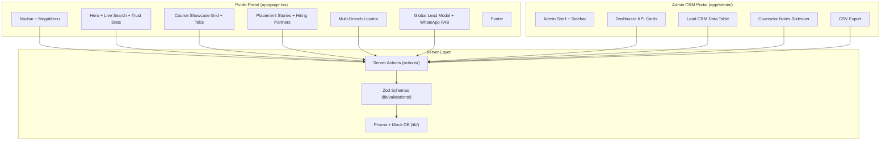

# IT Training, Certification & Placement Management Web Platform

Build a modern, full-featured IT Training, Certification, and Placement Management Web Platform with a public-facing landing page and an internal Admin Dashboard/Lead CRM.

## User Review Required

> [!IMPORTANT]
> **Dual Storage Strategy**: We will implement a full Prisma schema for PostgreSQL alongside a complete in-memory mock database (`lib/mock-db.ts`) so the entire application runs immediately without requiring a live PostgreSQL connection. When `DATABASE_URL` is configured, it seamlessly connects to PostgreSQL.

> [!IMPORTANT]
> **Tailwind CSS v4**: Since the user explicitly requires Tailwind CSS, we'll use Tailwind CSS (installed via npm). All styling will use Tailwind utility classes with modern patterns (glassmorphism, gradients, micro-animations).

> [!WARNING]
> **~35+ files** will be created. This is a full production-grade codebase. The build will take several minutes.

## Open Questions

1. **Authentication**: Should we implement real auth (NextAuth.js) for the admin dashboard, or use a simple mock/bypass for demo purposes?
2. **Branding**: Should the company be called "GreensTech" (matching workspace name) or a generic name like "TechPro Academy"?
3. **Image Assets**: Should I generate placeholder images for hero sections and student avatars, or use SVG placeholders?

---

## Architecture

---

## Proposed Changes

### 1. Project Configuration & Bootstrapping

#### [NEW] [package.json](file:///d:/greens/package.json)
Dependencies: `next`, `react`, `react-dom`, `typescript`, `@prisma/client`, `prisma`, `zod`, `react-hook-form`, `@hookform/resolvers`, `lucide-react`, `clsx`, `tailwind-merge`, `tailwindcss`, `postcss`, `autoprefixer`, `@types/react`, `@types/node`.

#### [NEW] [tsconfig.json](file:///d:/greens/tsconfig.json)
Strict TypeScript config with `@/*` path alias pointing to project root.

#### [NEW] [tailwind.config.ts](file:///d:/greens/tailwind.config.ts)
Custom color palette (emerald/teal/indigo/slate), extended animations (fadeIn, slideUp, marquee, pulse-glow), glassmorphism backdrop-blur utilities.

#### [NEW] [postcss.config.js](file:///d:/greens/postcss.config.js)
PostCSS with Tailwind and Autoprefixer.

#### [NEW] [next.config.ts](file:///d:/greens/next.config.ts)
Next.js configuration with image domains allowlist.

---

### 2. Database Schema & Data Layer

#### [NEW] [prisma/schema.prisma](file:///d:/greens/prisma/schema.prisma)
Complete schema with 7 models and 4 enums:
- **Models**: `User`, `Category`, `Course`, `Batch`, `Branch`, `Lead`, `PlacementStory`
- **Enums**: `Role` (ADMIN, COUNSELOR), `Mode` (CLASSROOM, ONLINE, HYBRID), `BatchStatus` (UPCOMING, ONGOING, COMPLETED), `LeadStatus` (NEW, CONTACTED, COUNSELING, ENROLLED, DROPPED)
- Full relations: Course→Category, Batch→Course+Branch, Lead→Branch+Course, User→Branch, PlacementStory→Course

#### [NEW] [lib/db.ts](file:///d:/greens/lib/db.ts)
Prisma client singleton (global caching for dev hot-reload).

#### [NEW] [lib/mock-db.ts](file:///d:/greens/lib/mock-db.ts)
Complete in-memory database with CRUD operations, filtering, pagination, and search. Used as fallback when no PostgreSQL is available.

#### [NEW] [lib/mock-data.ts](file:///d:/greens/lib/mock-data.ts)
Rich seed data:
- **5 Categories**: Full Stack Dev, Cloud & DevOps, Data Science/AI, Software Testing, Enterprise ERP
- **15+ Courses**: MERN Stack, Java Full Stack, AWS DevOps, Python AI/ML, Selenium, SAP, etc.
- **6 Branches**: Chennai, Bangalore, Hyderabad, Pune, Mumbai, Delhi
- **20+ Placement Stories**: Students placed at Google, Amazon, TCS, Infosys, Wipro, etc.
- **10+ Sample Leads**: Various statuses for CRM demo

---

### 3. Validation Schemas

#### [NEW] [lib/validations/schema.ts](file:///d:/greens/lib/validations/schema.ts)
Zod schemas:
- `publicLeadSchema`: Name (2-100 chars), Email, Phone (10-digit Indian), courseId, branchId
- `leadStatusUpdateSchema`: leadId, newStatus (enum), note (optional)
- `courseCreateSchema`: Title, slug, categoryId, summary, duration, mode, price, syllabusJson, isFeatured
- `batchCreateSchema`: courseId, branchId, instructorName, startDate, timing, maxSeats
- `leadFilterSchema`: search, status, branchId, courseId, dateFrom, dateTo, page, pageSize

---

### 4. Server Actions

#### [NEW] [actions/leads.ts](file:///d:/greens/actions/leads.ts)
- `submitPublicLead(formData)` — Validates, checks duplicates by email+courseId, inserts lead
- `updateLeadStatus(leadId, newStatus, note)` — Updates status, appends timestamped counselor note
- `getLeads(filters)` — Paginated, filtered, searchable lead list for CRM
- `getLeadById(id)` — Single lead with full details
- `exportLeadsCsv(filters)` — Generates CSV string for download
- `getDashboardStats()` — Aggregated KPI metrics

#### [NEW] [actions/courses.ts](file:///d:/greens/actions/courses.ts)
- `getFeaturedCourses()` / `getCoursesByCategory(categoryId)` / `searchCourses(query)` / `getAllCategories()`

#### [NEW] [actions/batches.ts](file:///d:/greens/actions/batches.ts)
- `getUpcomingBatches()` / `createBatch(data)` / `getBatchesByCourse(courseId)`

---

### 5. Public Landing Page Components

#### [NEW] [app/layout.tsx](file:///d:/greens/app/layout.tsx) & [app/globals.css](file:///d:/greens/app/globals.css)
Root layout with Inter font (Google Fonts), metadata, toast provider, and global CSS with custom keyframe animations.

#### [NEW] [app/page.tsx](file:///d:/greens/app/page.tsx)
Assembles all public sections: Navbar → Hero → CourseGrid → PlacementSection → BranchLocator → Footer + LeadModal + WhatsApp FAB.

#### [NEW] [components/Navbar.tsx](file:///d:/greens/components/Navbar.tsx)
- Sticky glassmorphism top bar with logo
- Categorized mega-menu dropdown (5 categories with course links)
- Branch selector with click-to-call phone numbers
- "Book Free Demo" CTA button
- Mobile hamburger → slide-out drawer with all links

#### [NEW] [components/Hero.tsx](file:///d:/greens/components/Hero.tsx)
- Bold gradient headline ("Launch Your IT Career")
- Live search bar with category chip filters
- Trust stats strip (100% Placement, 50K+ Trained, 20+ Branches, 500+ Hiring Partners)
- Side quick lead capture form widget
- Animated background gradient mesh

#### [NEW] [components/CourseGrid.tsx](file:///d:/greens/components/CourseGrid.tsx)
- Horizontal scrollable category tabs
- Responsive grid of course cards
- Each card: title, duration badge, mode badge (Classroom/Online/Hybrid), salary expectation, "View Syllabus" expand, "Enroll Now" modal trigger
- Hover lift animation, gradient borders

#### [NEW] [components/PlacementSection.tsx](file:///d:/greens/components/PlacementSection.tsx)
- Infinite CSS marquee of hiring partner logos (Google, Microsoft, Amazon, TCS, Infosys, Wipro, etc.)
- Student placement cards: avatar, name, company, role, package CTC
- Animated counter for total placements

#### [NEW] [components/BranchLocator.tsx](file:///d:/greens/components/BranchLocator.tsx)
- Grid of branch cards with address, city, phone (click-to-call `tel:` link), WhatsApp (`https://wa.me/` link)
- Google Maps embed toggle per branch
- Search/filter by city

#### [NEW] [components/LeadModal.tsx](file:///d:/greens/components/LeadModal.tsx)
- Backdrop-blur overlay modal
- React Hook Form + Zod validation
- Fields: Full Name, Email, Phone (10-digit), Course dropdown, Branch dropdown
- Server Action submission with success/error toast
- Floating WhatsApp button (bottom-right corner)

#### [NEW] [components/Footer.tsx](file:///d:/greens/components/Footer.tsx)
- 4-column footer: About, Courses, Branches, Contact
- Social media links, certification badges
- Copyright bar

#### [NEW] [lib/utils.ts](file:///d:/greens/lib/utils.ts)
- `cn()` utility (clsx + tailwind-merge)

---

### 6. Admin Dashboard & CRM Portal

#### [NEW] [app/admin/layout.tsx](file:///d:/greens/app/admin/layout.tsx)
Admin layout shell with sidebar + top header, responsive collapse.

#### [NEW] [components/admin/Sidebar.tsx](file:///d:/greens/components/admin/Sidebar.tsx)
- Collapsible sidebar with icon + text links
- Navigation: Overview, Lead CRM, Courses, Batches, Branches, Users
- Active state highlighting, tooltip on collapse
- Mobile overlay drawer

#### [NEW] [components/admin/AdminHeader.tsx](file:///d:/greens/components/admin/AdminHeader.tsx)
- Top bar with sidebar toggle, search input, role badge (ADMIN), and logout button

#### [NEW] [app/admin/page.tsx](file:///d:/greens/app/admin/page.tsx)
Dashboard overview:
- **KPI Cards**: Total Leads, New Today, Total Enrolled, Active Batches, Conversion Rate %
- **Quick Actions**: "Add Walk-in Lead" drawer, "Create New Batch"
- **Recent Inquiries**: Live feed of latest 10 leads
- **Upcoming Batches**: Table with course, branch, start date, seats

#### [NEW] [app/admin/leads/page.tsx](file:///d:/greens/app/admin/leads/page.tsx)
Full CRM data table:
- **Filters bar**: Search input, Status multi-select, Branch dropdown, Course dropdown, Date range
- **Data table**: Sortable columns (Name, Email, Phone, Course, Branch, Status, Date)
- **Inline status dropdown**: Change lead status directly in table row via Server Action
- **Counselor Slide-over**: Click row to open side panel with full lead details, timestamped notes history, and "Add Note" form
- **Pagination**: Server-side with page size selector
- **CSV Export**: One-click download button

---

## File Creation Order

| Phase | Files | Purpose |
|-------|-------|---------|
| 1 | `package.json`, `tsconfig.json`, `next.config.ts`, `tailwind.config.ts`, `postcss.config.js` | Project scaffolding |
| 2 | `prisma/schema.prisma`, `lib/db.ts`, `lib/mock-db.ts`, `lib/mock-data.ts`, `lib/utils.ts` | Data layer |
| 3 | `lib/validations/schema.ts` | Validation |
| 4 | `actions/leads.ts`, `actions/courses.ts`, `actions/batches.ts` | Business logic |
| 5 | `app/globals.css`, `app/layout.tsx` | Global styles & layout |
| 6 | `components/Navbar.tsx`, `components/Hero.tsx`, `components/CourseGrid.tsx`, `components/PlacementSection.tsx`, `components/BranchLocator.tsx`, `components/LeadModal.tsx`, `components/Footer.tsx` | Public components |
| 7 | `app/page.tsx` | Public landing page |
| 8 | `components/admin/Sidebar.tsx`, `components/admin/AdminHeader.tsx` | Admin components |
| 9 | `app/admin/layout.tsx`, `app/admin/page.tsx`, `app/admin/leads/page.tsx` | Admin pages |
| 10 | Install dependencies & verify build | Verification |

---

## Verification Plan

### Automated Tests
- `npx tsc --noEmit` — TypeScript type checking
- `npm run build` — Next.js production build verification
- `npm run dev` — Dev server smoke test

### Manual Verification
1. **Public Portal**: Navigate landing page, test mega-menu, search courses, submit lead form, verify WhatsApp links, check branch locator
2. **Admin Dashboard**: Verify KPI cards render with mock data, test lead filters, inline status updates, counselor notes slideover, CSV export
3. **Responsive**: Test mobile drawer menu, responsive grid layouts, touch-friendly interactions
